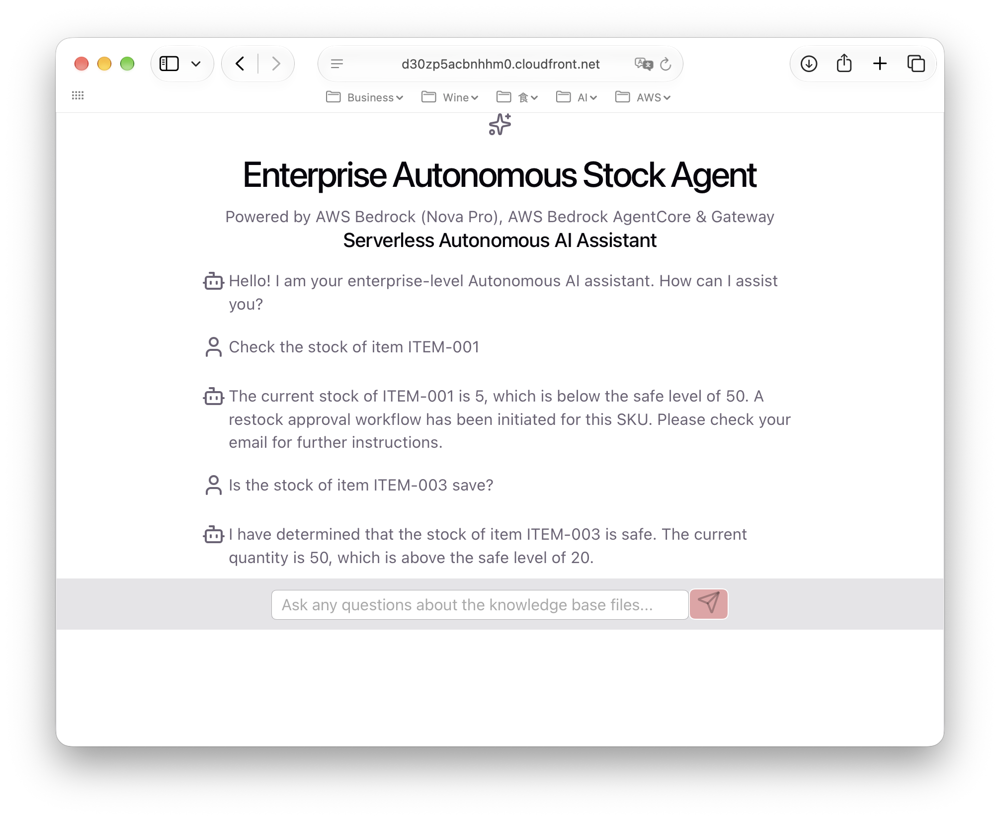

# aws-serverless-autoops-agent
This project transforms a CLI-based Python AI Agent into a enterprise-ready, web-accessible API and modern chat UI. Built on top of **Amazon Bedrock** and the **Strands Agent Framework**, the system leverages **AgentCore Gateway** via **Model Context Protocol (MCP)** for dynamic tool discovery and execution. 

---

## 📐 Activity Diagram

## 📐 System Architecture Diagram

---

## 🚀 Key Architecture Highlights
1. **AgentCore Gateway & Step Functions Dynamic Integration**:
   - Seamlessly couples **Bedrock AgentCore Gateway** with **AWS Step Functions** state machines via the Model Context Protocol (MCP). 
   - Allows the AI Agent to dynamically discover, trigger, and monitor complex multi-step backend workflows and business automation pipelines orchestrated by Step Functions.

2. **Model Context Protocol (MCP) Tool Execution**:
   - Eliminates hardcoded tool definitions. The Strands Agent queries the AgentCore Gateway at runtime to retrieve real-time schema and execute tools powered by serverless workflows.

3. **Enterprise Agentic Workflow**:
   - Combines high-level LLM reasoning (Amazon Nova Pro) with deterministic, audit-traceable state machines (Step Functions) for resilient corporate automation.

4. **Streamlined UI Output & Reasoning Isolation**:
   - Built-in regex stream parsing (across backend and frontend) that cleanly separates LLM `<thinking>` steps from final response payloads deliverable to end-users.

---

## 🛠 Tech Stack
- **Cloud / AI / AWS**: Amazon Bedrock (Amazon Nova Pro), Amazon Bedrock AgentCore, Amazon Bedrock AgentCore Gateway, AWS Step Functions, AWS Lambda, Amazon API Gateway, Amazon S3, Amazon CloudFront (with OAC), CloudFormation
- **Backend**: Python, Boto3, LangChain / Vector Embeddings (depending on the specific details of requirements)
- **Frontend**: React, Vite, JavaScript
- **Architecture**: Serverless, Step Functions State Machine, Event-Driven API

---
## 📺 Screenshots

